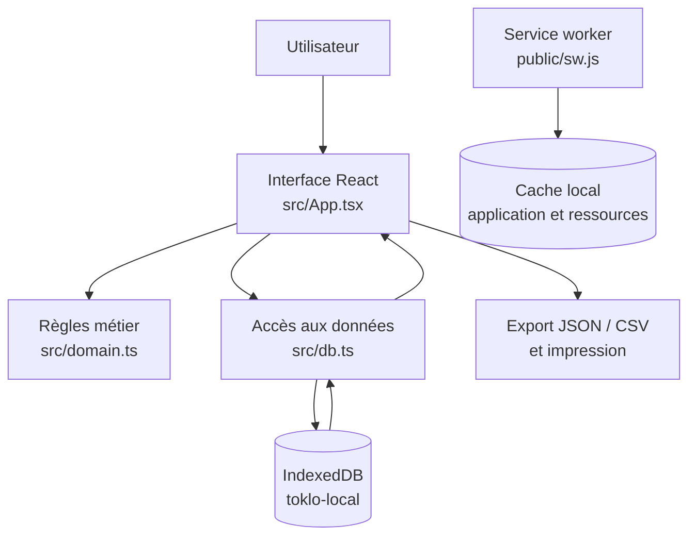

# Toklo

Toklo est une application web progressive (PWA) pensée pour gérer un atelier de couture depuis un téléphone ou un ordinateur. Elle regroupe les fiches clients, les mesures, les commandes, les rendez-vous et les paiements.

## Fonctionnalités

- **Clients** : coordonnées, catégorie, quartier, notes et consentement pour conserver une photo.
- **Mesures** : fiches par type de vêtement, champs personnalisés, centimètres ou pouces, date de retour et impression.
- **Commandes** : suivi des étapes de confection, essayage et livraison, prix, notes, photos de référence et note vocale.
- **Agenda** : rendez-vous, essayages et échéances associés aux clients.
- **Paiements et reçus** : saisie manuelle des sommes reçues, calcul du solde restant et reçu imprimable/partageable.
- **Tableau de bord** : aperçu de l'activité et des échéances à surveiller.
- **Sauvegarde** : export complet en JSON, export CSV des clients, mesures et commandes, et restauration d'une sauvegarde JSON.
- **Mode hors ligne** : les données et l'application sont conçues pour rester disponibles sur l'appareil après leur premier chargement.

Les paiements sont uniquement consignés dans Toklo : l'application ne traite pas de transactions financières.

## Architecture et conception

Toklo adopte une conception **local-first** : l'interface React fonctionne dans le navigateur et les données métier sont conservées dans IndexedDB sur l'appareil. Il n'y a pas de serveur applicatif ni d'API distante dans cette version.

La pile technique est React 18, TypeScript, Vite 8 et IndexedDB (via la bibliothèque `idb`). Vitest et `fake-indexeddb` servent aux tests.



### Rôle des principaux fichiers

| Fichier | Responsabilité |
| --- | --- |
| `src/main.tsx` | Démarre React et enregistre le service worker du navigateur. |
| `src/App.tsx` | Contient les écrans, formulaires, navigation, état de l'application et flux de sauvegarde/restauration. |
| `src/domain.ts` | Définit les types de vêtements et de mesures, transitions des commandes, calculs de soldes et alertes d'échéance. |
| `src/db.ts` | Encapsule IndexedDB : chargement, enregistrement, restauration et demande de stockage persistant. |
| `src/types.ts` | Décrit les entités et les statuts utilisés par l'application. |
| `src/styles.css` | Styles de l'interface bureau et mobile, dont la navigation responsive. |
| `src/domain.test.ts` | Tests des règles métier et de la persistance locale avec IndexedDB simulée. |
| `public/manifest.webmanifest` | Nom, icône et paramètres d'installation de la PWA. |
| `public/sw.js` | Mise en cache des ressources et repli pour servir l'application hors connexion. |
| `index.html` | Document HTML d'entrée et métadonnées de l'application. |

### Modèle de données

Les cinq ensembles de données sont reliés par identifiants :

- **Client** → plusieurs fiches de mesures, commandes et rendez-vous.
- **Commande** → plusieurs paiements.
- **Mesure** → client, vêtement, date, unité et valeurs saisies; la date de retour est facultative.
- **Rendez-vous** → client, date/heure, motif et statut.

Les enregistrements ont un identifiant et des dates de création/modification. Les clients archivés sont marqués comme supprimés plutôt qu'effacés immédiatement. IndexedDB possède des index par client pour les mesures, commandes et rendez-vous, et par commande pour les paiements.

### Parcours d'une donnée

Lorsqu'un formulaire est enregistré, l'interface valide les valeurs nécessaires, puis appelle la couche IndexedDB. Après l'écriture, l'application recharge les données locales et actualise l'écran. Les règles partagées (par exemple les soldes, l'ordre des statuts et les échéances à risque) sont regroupées dans `src/domain.ts`; les validations propres aux formulaires restent dans l'interface.

Le service worker met en cache les ressources de l'application à mesure qu'elles sont chargées. Le stockage des données et le cache de l'application sont distincts : vider les données du navigateur ou changer d'appareil ne transfère pas les fiches Toklo.

## Prérequis

- Node.js avec npm : Vite 8.3.8 requiert Node.js `^20.19.0` ou `>=22.12.0`.
- Un navigateur moderne. L'accès à la caméra et au microphone dépend des fonctionnalités du navigateur et des autorisations accordées.

## Lancer en développement

Depuis le dossier du projet, dans PowerShell ou un terminal :

```powershell
npm install
npm run dev
```

Ouvrez l'adresse affichée par Vite, généralement [http://localhost:5173](http://localhost:5173). Arrêtez le serveur avec `Ctrl+C`.

Pour tester l'interface sur téléphone, ouvrez le site sur un petit écran ou utilisez l'émulation mobile des outils de développement du navigateur.

## Construire et prévisualiser

```powershell
npm run build
npm run preview
```

La compilation TypeScript et la génération de la version de production sont effectuées par `npm run build`. Les fichiers publiables sont générés dans `dist/`. `npm run preview` sert cette version localement, généralement sur [http://localhost:4173](http://localhost:4173).

Pour installer la PWA et utiliser le service worker en production, déployez le contenu de `dist/` sur un hébergement HTTPS. `localhost` est également considéré comme une origine sécurisée pour le développement.

## Données, confidentialité et limites

- Les données restent dans le stockage du navigateur sur l'appareil courant. Elles ne sont ni synchronisées entre appareils, ni chiffrées par Toklo, ni envoyées à un serveur.
- La persistance dépend des quotas et des règles du navigateur. Les photos de commande et les notes vocales sont aussi conservées localement et peuvent consommer davantage d'espace.
- **Réglages → Télécharger une sauvegarde** produit un JSON complet. Gardez-en des copies régulières en dehors de l'appareil.
- **Exporter en CSV** fournit les clients, les mesures et les commandes; cet export n'inclut pas les paiements, rendez-vous, photos ou notes vocales.
- **Restaurer une sauvegarde** remplace les données locales de toutes les catégories après confirmation. Vérifiez le fichier et exportez l'état courant avant toute restauration.
- L'agenda affiche les événements dans l'application, mais n'envoie pas de notifications push.
- Les reçus peuvent être imprimés ou partagés, mais Toklo n'est pas un système de facturation certifié.

Avant d'utiliser Toklo avec des données réelles ou de le déployer à plusieurs utilisateurs, prévoyez une authentification, des autorisations et une sauvegarde sécurisée côté serveur, ainsi qu'une politique de confidentialité et de conservation adaptée. La version actuelle ne fournit ni comptes, ni rôles Patron/Apprenti, ni synchronisation cloud.

## Tests et commandes utiles

```powershell
npm test       # lance les tests Vitest
npm run build  # vérifie TypeScript et construit l'application
npm audit      # vérifie les vulnérabilités des dépendances npm
```

